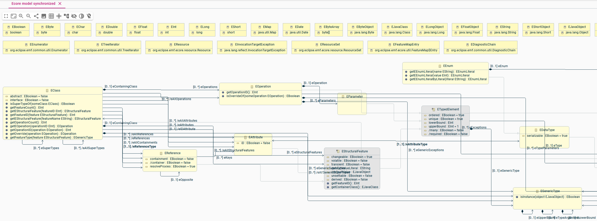

= Sirius*Components Ecore Tools

== Content

This repository contains a Sirius-components / Sirius-Web based modeler for Ecore metamodels.

It provides a single synchronized diagram view displaying the content of a diagram. A sample diagram is provided below:

== Features

=== Elements creation

* EPackage
** Inner elements (EClass, EDataType, EEnum)
* EClass (standard EClass, abstract and interfaces)
** EAttribute
** EOperation
* ESuperType relation
* EReferences (simple, composition, bidirectional, and bidirectional with composition)
* EDataType
* EEnum
** EEnumLiteral

=== Elements edition

* Direct edit for names of: 
** EClass
** EAttribute (complex including setting EType)
** EOperation (complex including setting EParameters, and return type)
** EDataType
** EEnum
** EEnumLiteral
* Edge reconnect for all edges

=== Project samples

- Ecore metamodel sample
- Simple and ugly Vehicle metamodel
- Empty metamodel

=== Import/Export

The standard import export features are available.