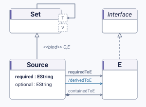

# Ecore Editor for Sirius Web

A browser-based editor for EMF Ecore metamodels, inspired by the **Design**
class diagram in [Eclipse EcoreTools](https://eclipse.dev/ecoretools/).
Built with Sirius Web, it edits standard `.ecore` models and provides a
reusable editor component plus a standalone application to try it out.



## Try it

You need JDK 21+, Maven, and Docker with Compose. The project currently uses
Sirius Web **2026.7.3** and Spring Boot **4.1.0**.
Sirius dependencies come from GitHub Packages; configure Maven credentials
for the repository IDs declared in [pom.xml](pom.xml).

From the repository root:

```sh
mvn clean verify
docker compose up -d --wait
java -jar sirius-components-ecore-editor-application/target/ecore-editor.jar \
  --spring.profiles.active=dev --server.port=8083
```

Open [localhost:8083](http://localhost:8083) and create a project using the
**Example** template. It includes a model and a ready-to-edit diagram with
classes, generics, references, opposites, an enum, and a constraint.

PostgreSQL runs on local port **5435** with its own persistent volume.
`docker compose stop` keeps your data. Outside the `dev` profile, set
`SPRING_DATASOURCE_URL`, `SPRING_DATASOURCE_USERNAME`, and
`SPRING_DATASOURCE_PASSWORD` for your database.

## Work with a diagram

- Create classifiers and packages with the diagram palette. In a new empty
  diagram, use **Import existing elements** or drag elements from the explorer.
  **Import related elements** adds types connected to a selected element.
- Classifiers and packages are added explicitly. Their attributes, operations,
  literals, type parameters, and relationships update automatically.
  A reference appears as an edge when its target is visible, or as a row in
  its owning class when the target is hidden or missing.
- Edit labels directly using EcoreTools syntax: `name : EString = initial`,
  `[0..*] children`, or `find(query : EString) : Book`. Both ends of an opposite
  reference have independently editable labels. References can target generic
  type parameter ports such as `T`.
- **Bidirectional reference** creates both opposite references in one action.
  Deleting a reference, whether shown as an edge or a class member, also deletes
  its opposite. Both owners must be editable.
- Reconnect either end of a reference or inheritance edge by dragging its
  endpoint. Opposite references move together. Inheritance cycles, duplicate
  supertypes, and edits to read-only elements are rejected. For an inheritance
  edge projected through a hidden parent, import the direct parent first.
  These indirect inheritance links are dotted. New supertype links initialize
  one generic argument per target type parameter, displayed as `?` until set.
- Mandatory attributes and references use bold labels; derived features use
  a `/` prefix and blue labels. EMF validation errors turn borders and labels red.
  Neutral cards use colored header accents with the original Ecore SVG icons.
  Relationship labels have transparent backgrounds; selection uses Sirius Web's
  native magenta feedback.
- Add **Documentation** from the background or an element's palette.
  **Assign annotation** attaches a note to an element or reference; reconnect
  its target end to move it. A target that already has documentation is rejected
  with a message, preserving both notes and their text. Constraints have a
  separate style and editable text.
- **Remove from diagram** keeps the model element. **Delete from model** deletes
  it. Downloaded Ecore documents retain the `.ecore` extension.

## Reuse the editor

| Module | Purpose |
| --- | --- |
| `sirius-components-ecore-editor` | View descriptions, AQL services, label editing, validation styles, and SVG icons |
| `sirius-components-ecore-editor-application` | Spring Boot application with the standard Sirius Web frontend and Example template |

Run `mvn install` from the root, then add the component to a compatible
Sirius Web application:

```xml
<dependency>
  <groupId>fr.obeo.ecore</groupId>
  <artifactId>sirius-components-ecore-editor</artifactId>
  <version>0.1.0-SNAPSHOT</version>
</dependency>
```

Import its Spring configuration:

```java
@Import(fr.obeo.ecore.editor.EcoreEditorConfiguration.class)
```

The host application supplies Sirius Web and persistence. The component
registers the Ecore metamodel, EMF Edit support, views, services, and icons.

## Tests

`mvn verify` runs the Java tests across the whole reactor. With the application
running, exercise the public GraphQL API and Example template:

```sh
python3.13 -m venv .venv
.venv/bin/pip install -r tests/requirements.txt
.venv/bin/python tests/smoke.py http://localhost:8083
.venv/bin/python tests/example.py http://localhost:8083
```

These scripts create projects and leave them available for inspection.

## Scope and license

This project focuses on the EcoreTools Design class diagram. Runtime metamodel
registration, code generation, and the other Desktop viewpoints are outside
its current scope.

Project sources and assets are distributed under **EPL-2.0**. See [LICENSE](LICENSE)
for the terms and [NOTICE](NOTICE) for EcoreTools, EMF, and Sirius Web attributions.
