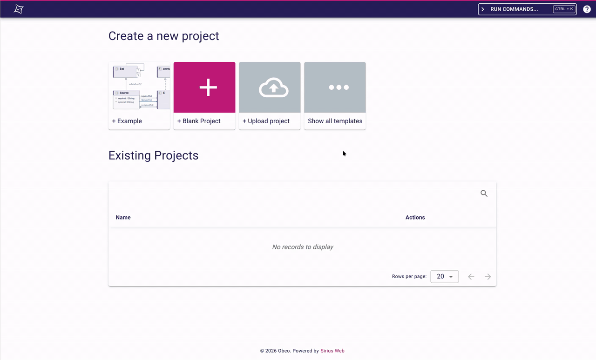

# Ecore Editor for Sirius Web

A browser-based editor for EMF Ecore metamodels, inspired by the **Design**
class diagram in [Eclipse EcoreTools](https://eclipse.dev/ecoretools/).
Built with Sirius Web, it edits standard `.ecore` models and provides a
reusable editor component plus a standalone application to try it out.



Creating and editing Ecore models in the browser (2× speed).
[View the example class diagram](sirius-components-ecore-editor-application/src/main/resources/project-templates/ecore-example.svg).

## Compatibility

**The current Ecore Editor code is built and tested against Sirius Web
2026.7.3. Use exactly Sirius Web 2026.7.3 in the application embedding it.**

| Ecore Editor version | Sirius Web version | Spring Boot version | Java |
| --- | --- | --- | --- |
| `0.1.0-SNAPSHOT` | **`2026.7.3`** | `4.1.0` | `21` or newer |

This applies to both the reusable component and the standalone application.
Keep all Sirius Web backend artifacts and the Sirius Web frontend on `2026.7.3`;
mixing Sirius Web versions is unsupported. Compatibility with other `2026.x`
versions has not been established. The source of truth for these versions is
[the reactor POM](ecore-editor-releng/pom.xml).

## Try it

You need JDK 21+, Maven 3.9+, and Docker with Compose. Configure
[Maven credentials](#maven-credentials) before building: Sirius Web dependencies
are downloaded from GitHub Packages.

From the repository root:

```sh
mvn -f ecore-editor-releng/pom.xml clean verify
docker compose -f ecore-editor-releng/compose.yaml up -d --wait
java -jar sirius-components-ecore-editor-application/target/ecore-editor.jar \
  --spring.profiles.active=dev --server.port=8083
```

Open [localhost:8083](http://localhost:8083) and create a project using the
**Example** template. It includes a model and a ready-to-edit diagram with
classes, generics, references, opposites, an enum, and a constraint.
Studio is enabled for all projects, including existing ones. The standard
**Studio** and **Blank Studio** templates are also available.

To create instances, save an Ecore model with a unique package namespace URI,
then open an instance project. Use **+ → New model** and select
the **package name** in **Model type**. If several packages share a name, their
labels also include their namespace URI. This creates an empty document. Use its
**New root object** action to select the domain (package namespace URI) and a
concrete class, following Sirius Web's standard root creation flow.
**Ecore model**, **Domain**, and **View** create their corresponding
documents; use View documents to describe representations for your instances.
Metamodels are loaded from saved Ecore documents when a project opens. Reopen
the instance project after editing a metamodel; existing instances are not
automatically migrated after structural changes.

PostgreSQL runs on local port **5435** with its own persistent volume.
`docker compose -f ecore-editor-releng/compose.yaml stop` keeps your data.
Outside the `dev` profile, set
`SPRING_DATASOURCE_URL`, `SPRING_DATASOURCE_USERNAME`, and
`SPRING_DATASOURCE_PASSWORD` for your database.

## Import into Eclipse

Use **File → Import → Maven → Existing Maven Projects**, select the repository
root, and import all three projects. The releng project owns the parent POM;
m2e configures the Java projects from their POMs. Java 21 and m2e are required.
For an existing workspace, remove the old `ecore-editor-parent` entry without
deleting its files, import `ecore-editor-releng`, then run **Maven → Update
Project** on all three projects.

## Work with a diagram

- Create classifiers and packages with the diagram palette. In a new empty
  diagram, use **Import existing elements** or drag elements from the explorer.
  **Import related elements** adds types connected to a selected element.
- Classifiers and packages are added explicitly. Their attributes, operations,
  literals, type parameters, and relationships update automatically.
  A reference appears as an edge when its target is visible, or as a row in
  its owning class when the target is hidden or missing.
- Edit labels directly using EcoreTools syntax: `name : EString = initial`,
  `[0..*] children`, or `find(query : EString) : Book`. Both ends of an opposite
  reference have independently editable labels. References can target generic
  type parameter ports such as `T`.
- **Bidirectional reference** creates both opposite references in one action.
  Deleting a reference, whether shown as an edge or a class member, also deletes
  its opposite. Both owners must be editable.
- Reconnect either end of a reference or inheritance edge by dragging its
  endpoint. Opposite references move together. Inheritance cycles, duplicate
  supertypes, and edits to read-only elements are rejected. For an inheritance
  edge projected through a hidden parent, import the direct parent first.
  These indirect inheritance links are dotted. New supertype links initialize
  one generic argument per target type parameter, displayed as `?` until set.
- Mandatory attributes and references use bold labels; derived features use
  a `/` prefix and blue labels. EMF validation errors turn borders and labels red.
  Neutral cards use colored header accents with the original Ecore SVG icons.
  Relationship labels have transparent backgrounds; selection uses Sirius Web's
  native magenta feedback.
- Packages contain freely positioned classes, data types, enumerations and
  nested packages. Use their palette to create or import elements.
- Add **Documentation** from the background or an element's palette.
  **Assign annotation** attaches a note to an element or reference; reconnect
  its target end to move it. A target that already has documentation is rejected
  with a message, preserving both notes and their text. Constraints have a
  separate style and editable text.
- **Remove from diagram** keeps the model element. **Delete from model** deletes
  it. Downloaded Ecore documents retain the `.ecore` extension.

## Reuse the editor

| Module | Purpose |
| --- | --- |
| `ecore-editor-releng` | Parent POM, complete Maven reactor, Docker Compose, and API checks |
| `sirius-components-ecore-editor` | View descriptions, AQL services, label editing, validation styles, and SVG icons |
| `sirius-components-ecore-editor-application` | Spring Boot application with the standard Sirius Web frontend and Example template |

Artifacts use group ID `fr.obeo.ecore` and are published to
[`https://maven.pkg.github.com/obeonetwork/ecoretools`](https://github.com/ObeoNetwork/EcoreTools/packages)
after a successful [publication workflow](#github-actions-and-publication).
The reusable dependency is `sirius-components-ecore-editor`; the application
artifact is an executable Spring Boot JAR. The reactor's parent POM and source
JARs are published as well, so consumers can resolve the parent chain and browse
the component sources in their IDE.

**Access:** GitHub's Maven packages inherit repository permissions. While
`ObeoNetwork/EcoreTools` is private, consumers must have read access to that
repository. A package token alone does not grant access. Even public Maven
packages on GitHub require authentication. See
[GitHub's Maven registry documentation](https://docs.github.com/en/packages/working-with-a-github-packages-registry/working-with-the-apache-maven-registry).

### Maven credentials

Create a GitHub **personal access token (classic)** with `read:packages`, owned
by an account that can read the required packages and this repository. Authorize
the token for organization SSO if required. Export its username and token in your
build environment as `MAVEN_USERNAME` and `MAVEN_READ_TOKEN`; keep the token out
of source control.

Add these servers to `~/.m2/settings.xml`, merging with any existing settings.
The IDs must match the repository IDs used in the POMs:

```xml
<settings xmlns="http://maven.apache.org/SETTINGS/1.0.0">
  <servers>
    <server>
      <id>github-ecore-editor</id>
      <username>${env.MAVEN_USERNAME}</username>
      <password>${env.MAVEN_READ_TOKEN}</password>
    </server>
    <server>
      <id>github-sirius-web</id>
      <username>${env.MAVEN_USERNAME}</username>
      <password>${env.MAVEN_READ_TOKEN}</password>
    </server>
    <server>
      <id>github-sirius-emfjson</id>
      <username>${env.MAVEN_USERNAME}</username>
      <password>${env.MAVEN_READ_TOKEN}</password>
    </server>
  </servers>
</settings>
```

The Sirius Web and Sirius EMF JSON servers are also needed when building this
repository from source. This follows the
[Sirius Web dependency setup](https://github.com/eclipse-sirius/sirius-web#github-access-token).

### Consumer POM

Use the following Maven configuration in your Sirius Web host application.
If you already have a POM, merge these repositories and dependencies into it,
keeping its Sirius Web version at **`2026.7.3`** and Spring Boot at **`4.1.0`**.
Keep the **Liquibase `4.33.0`** pin as well: it matches this application's
configuration and overrides Spring Boot 4.1.0's default Liquibase 5 version.
The example assumes that `0.1.0-SNAPSHOT` has been published successfully.

```xml
<project xmlns="http://maven.apache.org/POM/4.0.0">
  <modelVersion>4.0.0</modelVersion>
  <parent>
    <groupId>org.springframework.boot</groupId>
    <artifactId>spring-boot-starter-parent</artifactId>
    <version>4.1.0</version>
    <relativePath/>
  </parent>
  <groupId>com.example</groupId>
  <artifactId>my-ecore-modeler</artifactId>
  <version>1.0.0-SNAPSHOT</version>
  <properties>
    <java.version>21</java.version>
    <sirius.web.version>2026.7.3</sirius.web.version>
    <liquibase.version>4.33.0</liquibase.version>
  </properties>
  <repositories>
    <repository>
      <id>github-ecore-editor</id>
      <url>https://maven.pkg.github.com/obeonetwork/ecoretools</url>
      <snapshots><enabled>true</enabled></snapshots>
    </repository>
    <repository>
      <id>github-sirius-web</id>
      <url>https://maven.pkg.github.com/eclipse-sirius/sirius-web</url>
    </repository>
    <repository>
      <id>github-sirius-emfjson</id>
      <url>https://maven.pkg.github.com/eclipse-sirius/sirius-emf-json</url>
      <snapshots><enabled>true</enabled></snapshots>
    </repository>
  </repositories>
  <dependencies>
    <dependency>
      <groupId>org.eclipse.sirius</groupId>
      <artifactId>sirius-web-starter</artifactId>
      <version>${sirius.web.version}</version>
    </dependency>
    <dependency>
      <groupId>org.eclipse.sirius</groupId>
      <artifactId>sirius-web-frontend</artifactId>
      <version>${sirius.web.version}</version>
    </dependency>
    <dependency>
      <groupId>fr.obeo.ecore</groupId>
      <artifactId>sirius-components-ecore-editor</artifactId>
      <version>0.1.0-SNAPSHOT</version>
    </dependency>
  </dependencies>
</project>
```

Import the editor's Spring configuration from your application:

```java
@Import(fr.obeo.ecore.editor.EcoreEditorConfiguration.class)
```

The host application supplies Sirius Web and persistence. The component
registers the Ecore metamodel, EMF Edit support, views, services, and icons.
Build the host with `mvn verify`; use `mvn -U verify` to refresh a snapshot.
For local development without publishing, first run
`mvn -f ecore-editor-releng/pom.xml install` from this repository's root.

For a consuming GitHub Actions build, configure a `MAVEN_USERNAME` repository
variable and a `MAVEN_READ_TOKEN` Actions secret with the same read credentials.
The Java setup step can generate the matching Maven servers:

```yaml
- uses: actions/setup-java@b843ebf9b913146b38da2eaa7aeddf76074ae1ad # v6.1.0
  with:
    distribution: temurin
    java-version: '21'
    cache: maven
    mvn-server-credentials: |
      github-ecore-editor:MAVEN_USERNAME:MAVEN_READ_TOKEN
      github-sirius-web:MAVEN_USERNAME:MAVEN_READ_TOKEN
      github-sirius-emfjson:MAVEN_USERNAME:MAVEN_READ_TOKEN
- run: mvn --batch-mode --no-transfer-progress verify
  env:
    MAVEN_USERNAME: ${{ vars.MAVEN_USERNAME }}
    MAVEN_READ_TOKEN: ${{ secrets.MAVEN_READ_TOKEN }}
```

Run these steps after checkout. A consuming repository's `GITHUB_TOKEN` does
not automatically grant access to packages in this repository; use the read
token described above.

## GitHub Actions and publication

[`.github/workflows/build.yml`](.github/workflows/build.yml) builds the complete
Maven reactor on Java 21 for pushes to `main`, `v*` tags, pull requests targeting
`main` from this repository, and manual runs. All Java tests run before publication.
Fork pull requests skip this workflow's build job because GitHub does not pass
the upstream dependency secret to forks. Contributors can configure credentials
in their own fork and run the workflow there; forks do not publish to this repository.

### Maintainer setup

In **Settings → Secrets and variables → Actions**, configure:

| Kind | Name | Value |
| --- | --- | --- |
| Repository variable | `MAVEN_USERNAME` | GitHub username that owns the dependency read token |
| Actions secret | `MAVEN_READ_TOKEN` | Classic PAT with `read:packages` for Sirius Web and Sirius EMF JSON |

Enable GitHub Actions and allow the workflow's publication job to request
`packages: write`. Publication uses the automatically supplied `GITHUB_TOKEN`
for **this repository**, rather than a personal write token. No Maven Central
account or signing key is needed. See
[GitHub's Maven publication guide](https://docs.github.com/en/actions/tutorials/publish-packages/publish-java-packages-with-maven).

| Trigger | Publication |
| --- | --- |
| Push to `main` with a `-SNAPSHOT` POM version | Publishes that snapshot after verification |
| Push a `vVERSION` tag | Publishes the matching non-snapshot Maven version after verification |
| Pull request, manual run, or push to `main` with a non-snapshot version | Verification only |

Publication is restricted to `ObeoNetwork/EcoreTools`. Maven deploys the entire
reactor, including its parent POM, to the repository declared in
`distributionManagement`. The publish job rebuilds the verified commit with
`-DskipTests` and defers uploads until all reactor modules finish packaging.

### Release a version

For example, to prepare `0.1.0`, update **all three POM versions** together:

```sh
mvn -f ecore-editor-releng/pom.xml versions:set \
  -DnewVersion=0.1.0 -DprocessAllModules=true -DgenerateBackupPoms=false
mvn -f ecore-editor-releng/pom.xml clean verify
```

Update the compatibility table and consumer version in this README, commit the
version change, and push it to `main`. Tag that commit `v0.1.0` and push the tag
to trigger publication. The workflow rejects tags that differ from the POM
version or still contain `-SNAPSHOT`. A GitHub release object is optional.

Use a new version for each release; do not overwrite published release artifacts.
After publication, set all POMs to the next snapshot (for example
`0.1.1-SNAPSHOT`) with the same command, update the README, and commit that change
on `main`. Consumers can then select either the stable release or the snapshot.

## Tests

`mvn -f ecore-editor-releng/pom.xml verify` runs the Java tests across the whole
reactor. With the application running, exercise the public GraphQL API and Example
template from the releng project:

```sh
cd ecore-editor-releng
python3.13 -m venv .venv
.venv/bin/pip install -r tests/requirements.txt
.venv/bin/python tests/smoke.py http://localhost:8083
.venv/bin/python tests/example.py http://localhost:8083
.venv/bin/python tests/instances.py http://localhost:8083
```

The smoke and example checks leave their projects available for inspection.
The instance check removes its own temporary projects.

## Scope and license

This project focuses on the EcoreTools Design class diagram. The standalone
application includes native Studio Domain/View authoring and instantiation of
saved Ecore models. Code generation, automatic instance migration, and the other
Desktop viewpoints remain outside the current scope.

Project sources and assets are distributed under **EPL-2.0**. See [LICENSE](LICENSE)
for the terms and [NOTICE](NOTICE) for EcoreTools, EMF, and Sirius Web attributions.
